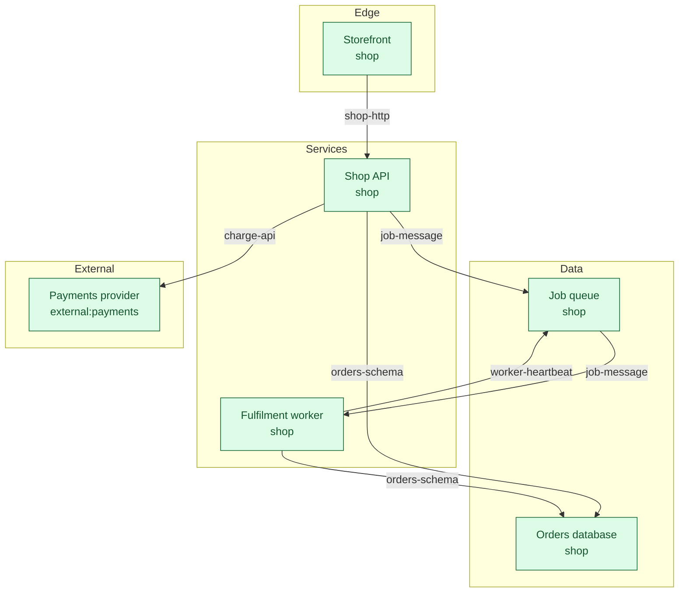
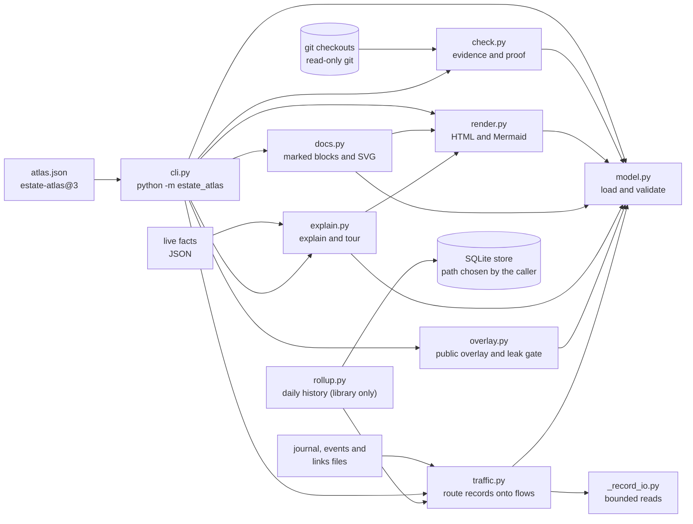

# estate-atlas

**Your architecture as checked data.**

[](https://github.com/Chris0Jeky/estate-atlas/actions/workflows/tests.yml)
[](https://github.com/Chris0Jeky/estate-atlas/actions/workflows/pages.yml)
[](https://github.com/Chris0Jeky/estate-atlas/blob/main/LICENSE)
[](https://github.com/Chris0Jeky/estate-atlas/blob/main/pyproject.toml)

## What it is and why it exists

estate-atlas keeps a system's architecture as one JSON file of components, contracts and flows. Each of them carries
evidence: a file, and optionally a text anchor, in a git repository. The checker reads that evidence from git, so the
map cannot quietly drift from the code.

Architecture diagrams go stale. The box says the worker writes to the database, someone changes the code, and the
diagram keeps saying the old thing until somebody notices. Treating the map as checked data turns that drift into a
failing check.

The same JSON file also drives the outputs: an offline HTML atlas, Mermaid diagrams, an SVG overview, Markdown
blocks that your docs can embed, and plain-English explanations. If you point it at log or event records, it routes
them onto the flows, so you can see which flows carry traffic and which have gone quiet.

It is a standard-library Python package with no runtime dependencies. It reads your atlas and your git checkouts.
The evidence checks use read-only git commands and never fetch, write or check out anything. Outputs are
byte-stable for the same inputs, so you can diff them and fail CI when they change unexpectedly.

This is the fictional shop in `examples/shop`, drawn by `render mermaid` from `examples/shop/atlas.json`:



## Features

- **An atlas format you can review.** `estate-atlas@3` (and `@2`) holds layers, components, contracts, flows,
  repos and vocabularies. Components and contracts can be `live`, `partial`, `planned` or `retired`. Flows can be
  `live`, `partial`, `documented`, `planned` or `absent`. Only planned items, and documented or absent flows, may
  carry `expect` references.
- **Evidence checks against git.** `check` confirms that each referenced file exists and contains its anchor text at
  `origin/<default branch>` of the matching checkout, or in the working tree with `--worktree`. Missing evidence is
  drift (exit 1). A repo it cannot resolve makes the report `partial` (exit 0), so an unresolved repo never looks green.
  `export` writes the same atlas as `estate-atlas-export@3`, with a GitHub URL on every evidence, expect, vocabulary
  and receipt revision.
- **Evidence levels.** A part can claim how far it has been proven on an ordered ladder, from `source` up to
  `accepted`. The claim has to be backed by passed receipts that pin commits on the default branch. `check` reports
  over-claims (exit 1) and under-claims. estate-atlas records receipts. It never runs the checks they describe.
- **Traffic routing.** `route` takes JSONL journal and event files, plus an optional links file, and puts each record
  on a flow. Declared rules win. Otherwise the record's endpoints are mapped to components, and a record that joins
  exactly one flow is inferred onto it. The rest is reported as `internal`, `unrouted` or `ambiguous`. Heartbeats
  can be declared as pulses, so they never count as traffic. A live flow that has a rule but sees no crossings is
  listed as silent.
- **Renderers.** `render html` writes one offline page with an evidence view. Scripts and styles are inline; the page
  loads no external assets. Clickable GitHub links are emitted for evidence that names a remote. `render mermaid`
  writes a flowchart in a `flows` or `components` view. `docs write` fills marked blocks in a Markdown file
  (`glance`, `owners`, `layers` and `traffic`) and writes an `atlas-glance.svg` beside it. `docs check` fails when
  those blocks have gone stale.
- **Explanations.** `explain` describes one component in plain English, using only facts from the atlas. Add
  `--traffic` for volumes from `route`, or `--live` for a running-now line from a JSON file of your own facts.
- **Tours, including public ones.** `tour --md` writes a walk through every layer and flow. `tour --overlay` writes
  the same tour in public wording from an overlay file. The overlay has to cover every layer, component, contract and
  flow, and the tour refuses to write anything (exit 2) if a private term would leak. Keep the overlay file with the
  private atlas. `tour --check` fails when a saved tour is stale.
- **Strict input.** Atlas and record files must be strict UTF-8 JSON, with or without a leading UTF-8 BOM. Duplicate
  keys, `NaN` and `Infinity` are rejected. JSONL input has per-line and per-file byte budgets and a record limit per
  file. A file that goes over one of them fails instead of being silently truncated.
- **Publishing checks.** `scripts/check_public.py` scans the working tree, the committed content or the full git
  history for private terms, home-directory paths and e-mail addresses. `scripts/qualify_wheel.py` builds the wheel,
  installs it into a clean virtual environment with no network access, runs the consumer proof, and writes a JSON
  receipt.

The CLI is `python -m estate_atlas <verb>`, or `estate-atlas` after `pip install .`. Exit codes: 0 ok, 1 drift or
stale, 2 invalid input.

| Verb | What it does |
| --- | --- |
| `validate` | Check that the atlas file is well formed. |
| `check` | Prove the evidence and proof receipts against git. |
| `export` | The atlas with a hosted link on every reference. |
| `render` | Offline HTML, or Mermaid (`flows` or `components`). |
| `docs` | Write or check marked Markdown blocks and the glance SVG. |
| `explain` | One component in plain English. |
| `tour` | A walk through every layer and flow. `--overlay` publishes it. |
| `route` | Route journal, event and link files onto flows (`estate-atlas-traffic@1`). |

`rollup.py` has no verb. It is a library: daily counts in SQLite, then weekly series and fading/surging flags.

## Architecture

The package is a set of plain modules under `estate_atlas/`. `model.py` loads and validates the atlas, and most other
modules build on it. `cli.py` holds the verbs and the exit codes. Each verb imports the modules it needs when it runs.



A few things to know when you read the code:

- `traffic.py` is a pure engine. The caller injects the readers for journal, event, link and atlas data.
  `route_files` is the file-backed wrapper that the `route` verb uses.
- `rollup.py` has no CLI verb. It is a library: `TrafficHistory` keeps daily counts in SQLite, and `weekly` and
  `flags` work on those counts.
- `scripts/build_docs_site.py` stages the GitHub Pages site and calls the same `cli.main` to render the example
  atlas, so the docs site shows real output.
- `check` calls only read-only git subcommands (`remote`, `config`, `rev-parse`, `ls-tree`, `cat-file` and
  `merge-base`) and never fetches. See [docs/DESIGN.md](docs/DESIGN.md) for the details.

## Quickstart

You need Python 3.11 or later. You need Git as well if you want to run `check`.

Clone the repository and run the example from the repository root. The example is a fictional shop in
`examples/shop`.

```sh
git clone https://github.com/Chris0Jeky/estate-atlas.git
cd estate-atlas

python -m estate_atlas validate examples/shop/atlas.json
python -m estate_atlas check examples/shop/atlas.json --repo shop=examples/shop --worktree
python -m estate_atlas route examples/shop/atlas.json --journal examples/shop/journal.jsonl --events examples/shop/events.jsonl
python -m estate_atlas explain examples/shop/atlas.json worker
python -m estate_atlas render html examples/shop/atlas.json --out atlas.html
python -m estate_atlas tour examples/shop/atlas.json --md --overlay tests/fixtures/shop-overlay.json
```

`check` needs `--worktree` for this example. The example's remote is a placeholder, so without it the report is
`partial` and the references are not proven. With it, all references resolve against the files in your checkout.

`explain` on the worker prints this:

```
Fulfilment worker (worker)
Fulfilment worker (shop) is live. Takes jobs off the queue, fulfils them and writes the result to the database. It owns job results.
Evidence: claimed unit; passed receipts reach integrated.
Fed by Job queue (A job is waiting and a worker is free.).
Feeds Job queue (Every minute the worker reports that it is alive.). Feeds Orders database (A job finishes and its result is stored.).
It reads Job message and Orders schema.
```

`route` on the sample journal and events lights `web-to-api`, `api-to-queue`, `queue-to-worker` and `api-to-db` as
hot, `worker-to-db` as warm, `worker-heartbeat` as pulse, and `api-to-payments` as silent: a live flow with a rule
and no crossings. `web-to-api` has no declared rule; those crossings are inferred from the components' instances.
See [examples/shop/README.md](examples/shop/README.md).

A second example, [examples/workspace](examples/workspace/README.md), is a planned human-workspace design. Every
component and flow is `planned`, there is no traffic, and `validate` is the command that applies:

```sh
python -m estate_atlas validate examples/workspace/atlas.json
```

To install the console script instead of using `python -m`, run `pip install .` from the repository root. Then
`estate-atlas` takes the same verbs.

To run the test suite:

```sh
python -m unittest discover -s tests -v
```

CI runs `python scripts/run_tests.py`, which does the same discovery and fails if it finds no tests.

### Your own atlas

An atlas names its repos, then points each claim at a file and, optionally, an anchor string inside it. This is a
complete atlas with two components, one contract and one flow. `validate` accepts it:

```json
{
  "schema": "estate-atlas@3",
  "updated": "2026-10-12",
  "repos": {"shop": {"remote": "example/shop", "default_branch": "main", "paths": {}}},
  "layers": [
    {"id": "services", "title": "Services", "summary": "The shop's own logic."},
    {"id": "data", "title": "Data", "summary": "Where state lives."}
  ],
  "components": [
    {
      "id": "api", "title": "Shop API", "layer": "services", "home": "shop", "status": "live",
      "summary": "Takes orders and schedules fulfilment.",
      "evidence": [{"repo": "shop", "path": "src/api.py", "anchor": "def handle_request"}],
      "instances": ["service:api"], "surfaces": [], "owns": []
    },
    {
      "id": "queue", "title": "Job queue", "layer": "data", "home": "shop", "status": "live",
      "summary": "Holds fulfilment jobs between the API and the worker.",
      "evidence": [{"repo": "shop", "path": "src/jobs.py", "anchor": "JOB_MESSAGE_FIELDS"}],
      "instances": ["service:queue"], "surfaces": [], "owns": []
    }
  ],
  "contracts": [
    {
      "id": "job-message", "title": "Job message", "producer": "api", "consumers": ["queue"],
      "format": "json", "status": "live", "summary": "The fields of one fulfilment job.",
      "evidence": [{"repo": "shop", "path": "src/jobs.py", "anchor": "JOB_MESSAGE_FIELDS"}]
    }
  ],
  "flows": [
    {
      "id": "api-to-queue", "from": "api", "to": "queue", "contract": "job-message",
      "trigger": "An order is saved and needs fulfilling.", "status": "live",
      "evidence": [{"repo": "shop", "path": "src/api.py", "anchor": "def handle_request"}],
      "traffic": [{"source": "journal", "producer": "api", "verb": "enqueue"}]
    }
  ]
}
```

`check` proves those references against a checkout of the `shop` repo, once the named files and anchors exist there.
The full format is described in [docs/DESIGN.md](docs/DESIGN.md). Start with `validate` and fix whatever it reports.

## Tech stack

- **Python 3.11+, standard library only.** `argparse` for the CLI, `json` with strict parsing, `subprocess` for
  read-only git calls, `sqlite3` for the rollup store, `unittest` for the tests. `dependencies` in `pyproject.toml`
  is empty.
- **Git.** The package's only subprocess is git, through `check.py`. `scripts/check_public.py` also reads git.
  `scripts/qualify_wheel.py` records the source HEAD and dirty status with git, then builds and installs the wheel
  in a clean virtual environment with pip.
- **Packaging.** setuptools (`setuptools>=68`) builds the wheel and provides the `estate-atlas` console script.
- **Output formats.** Self-contained HTML, Mermaid, SVG and Markdown. Every output is deterministic.
- **CI.** GitHub Actions runs the full suite on Ubuntu with Python 3.11 and on Windows with Python 3.13. A separate
  workflow stages the docs site and runs its tests, and a push to `main` deploys it to GitHub Pages with Jekyll.

## Status and roadmap

estate-atlas is pre-release. The package version is `0.1.0.dev0`, and the atlas format and CLI may still change
before 0.1.0.

Open work, from the issue tracker:

- [#43](https://github.com/Chris0Jeky/estate-atlas/issues/43): optional per-receipt source references for evidence levels.
- [#72](https://github.com/Chris0Jeky/estate-atlas/issues/72): `check` starts three git processes per evidence file,
  which is slow on Windows. A draft PR, [#83](https://github.com/Chris0Jeky/estate-atlas/pull/83), adds an evidence
  batching helper that is not wired into the checker yet.
- [#71](https://github.com/Chris0Jeky/estate-atlas/issues/71): review follow-ups on duplicate IDs in file routes,
  links strictness parity, the `READ_MAX` boundary and the duck-typed index.

Known limits, as documented in the design:

- By default `check` proves what the checkout's `origin/<default branch>` contains. `--worktree` reads the working
  files instead. Neither says anything about remote freshness, runtime behaviour or deployment.
- A partial clone is treated as unresolved, because `check` does not fetch missing objects.
- Day-bounded rollups fail closed when one day exceeds its row budget. There is no resumable reader yet.
- The public-overlay leak gate checks for private terms as substrings and whole words. It is a strong check, not a
  proof that nothing private remains.

## Public check

Before publishing, check both the content about to be staged and the committed content:

```
python scripts/check_public.py
python scripts/check_public.py --committed
python scripts/check_public.py --history
```

The default mode scans working-tree text and tracked file names. `--committed` scans the names and blobs
at HEAD, so a dirty cleanup, deletion or staged replacement cannot hide committed content. Both modes scan
symlink text without following the link; default mode also checks the index's symlink text. Gitlink names
are checked, but submodule contents are not. Deleted working files have no content in default mode.
UTF-16/UTF-32 text with a BOM is decoded. Without a BOM, a NUL byte in the first 8 KiB marks binary content,
which is not scanned; its name is still checked.

`--history` scans `git log -m -p --all`, including merge-parent diffs, messages, author lines and ref names.
Git C-quoted paths are decoded before matching. Wrapped private terms are checked within each text file,
commit message and each side of each diff hunk, never by joining separate files, hunk sides or metadata.
History is a text-diff scan, not a complete binary/archive scan: an unchanged part outside a diff hunk is
not examined in that commit. Commits and repeated merge-parent hits are counted once.

The scan reuses the evidence checker's read-only Git boundary, disables replacement objects and lazy
fetching, and refuses partial clones or unreadable Git configuration. It never repairs history. Exit 0
means no detected hits in the selected scope, 1 means hits, and 2 means the scan could not complete.
A hit prints `path:line: category` with at most a masked excerpt.

The committed patterns are generic: absolute home-directory paths, default Windows host names, e-mail
addresses (examples and no-reply forms excepted) and `.ts.net` hosts. Private terms live one per line in
the gitignored `.public-scan.local` (or `--terms FILE`); they are reported only by their position in that
file. `allow: PATH = TERM` accepts that term only in the exact file path and its name, in tree and history
modes. Accepted hits are counted. File allowances never suppress author, commit-message or ref findings.
Keep that terms file private. A clean scan does not establish that an artifact is safe to publish.

## Contributing

Keep changes small, with tests, and one pull request per change. The rules that matter most:

- Standard library only, on Python 3.11 or later. No runtime dependencies.
- Outputs are deterministic. Renderers and generated blocks must be byte-stable for the same inputs.
- The tool is read-only against git. `check` never fetches, writes or checks out. It reads with `git remote`,
  `config`, `rev-parse`, `ls-tree`, `cat-file` and `merge-base`.
- Never put private repository, host, person or path names in code, tests, examples or docs. Examples are
  fictional, and `examples/shop` is the reference.

Run the tests and the public scan before you open a PR. The full rules are in [AGENTS.md](AGENTS.md).

## Links

- [Design](docs/DESIGN.md): the format, evidence rules, routing, the public overlay and the CLI reference.
- [Qualification](docs/QUALIFICATION.md): how to run the consumer and installed-package proofs, and what their results do and do not prove.
- [Origin identity](docs/ORIGIN_IDENTITY.md): which git remotes count as GitHub evidence.
- [Shop example](examples/shop/README.md): the fictional storefront used throughout this README.
- [Workspace example](examples/workspace/README.md): a planned human-workspace design, all `planned`, no traffic.
- [Docs site](https://chris0jeky.github.io/estate-atlas/): the rendered docs.
- [Interactive example atlas](https://chris0jeky.github.io/estate-atlas/example/shop-atlas.html): the fictional shop, rendered with the package's own HTML renderer.
- [License](LICENSE): GPL-3.0-only.
